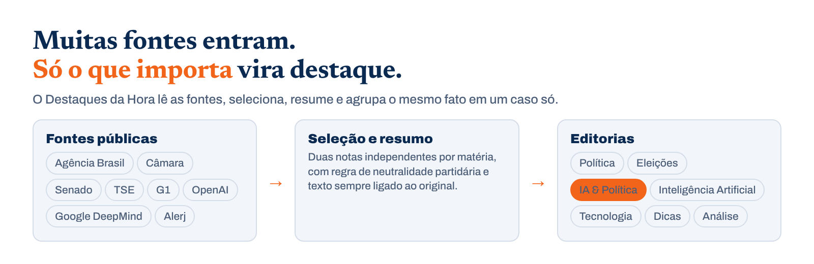
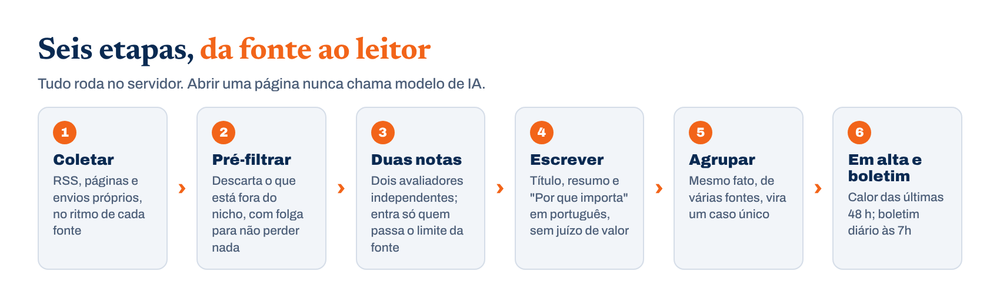
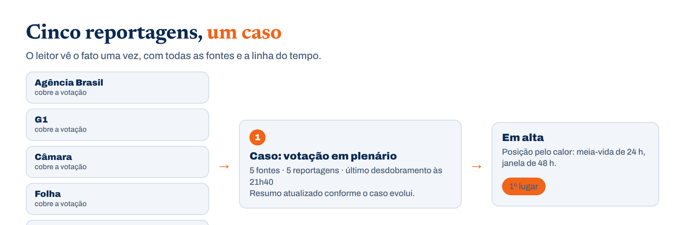

<p align="center">
  <picture>
    <source media="(prefers-color-scheme: dark)" srcset="docs/assets/banner-dark.png">
    
  </picture>
</p>

<p align="center">
  <a href="LICENSE"></a>
  
  
  
</p>

<p align="center">
  <b>Um portal que encontra os destaques sozinho e escreve o boletim do dia.</b><br>
  O portal do Rio de Janeiro: política, IA, tecnologia, Brasil, mundo, esportes e cinema.
</p>

<p align="center">
  <b>Português (Brasil)</b> · <a href="README.en.md">English</a>
</p>

<p align="center">
  <a href="#como-rodar">Como rodar</a> ·
  <a href="docs/customize.md">Personalizar</a> ·
  <a href="#como-funciona">Como funciona</a> ·
  <a href="#documentação">Documentação</a>
</p>

<br>

## O que é

O **Destaques da Hora** é um portal de notícias do Rio de Janeiro. Todo dia ele coleta material de um conjunto de fontes, passa por uma triagem feita por modelo de linguagem, dá nota duas vezes de forma independente, escolhe o que realmente vale a leitura e escreve título e resumo em português. Reportagens de fontes diferentes sobre o mesmo fato são agrupadas em um só evento, e os eventos são ordenados por quantas fontes falam deles. Toda manhã sai um boletim do dia.

Editorias: Política (nacional e Rio de Janeiro), Eleições, IA & Política, Inteligência Artificial, Tecnologia, Brasil, Mundo, Esportes, Cinema e Séries, Dicas e Análise, além do **Destaque: Rio de Janeiro**, com o que acontece no estado, na capital e na região metropolitana.

## Origem e créditos

Este projeto é um fork em português do Brasil do [AIHOT](https://github.com/KKKKhazix/AIHOT), motor e framework de código aberto criado por KKKKhazix e licenciado sob MIT. O texto da licença e o aviso de terceiros foram mantidos em [LICENSE](LICENSE) e [NOTICE](NOTICE). O nome e o logotipo do AIHOT não fazem parte da licença e **não são usados aqui**.

O que é próprio deste portal fica em [`site/`](site/) (nome, textos, marca, páginas de termos e privacidade) e em [`industry/`](industry/) (categorias, temas, fontes, prompts e limiares de seleção). Quem quiser acompanhar as atualizações do AIHOT pode mesclar a partir do repositório original; por isso os nomes internos do motor foram mantidos.

## Como funciona

<picture>
  <source media="(prefers-color-scheme: dark)" srcset="docs/assets/how-dark.png">
  
</picture>

Um item entra pela fonte, é checado contra duplicatas e passa pelo pré-filtro. O que pode ser importante recebe duas notas independentes, ganha título e resumo em português, é agrupado com outras reportagens em um evento e entra no cálculo de popularidade. Quando uma publicação do X não tem texto ou traz só um link, o portal guarda o link e as imagens do post original e não chama modelo de redação nem de tradução. Só entra na seleção o que passa do limiar e não repete uma notícia já selecionada. O boletim do dia é montado por regras; o resumo semanal e o balanço mensal são compilados a partir dos boletins. Os prompts de cada etapa estão em [`industry/prompts/`](industry/prompts/): mudar o critério não exige mudar código. Detalhes em [Seleção e calibração](docs/selection.md).

### Agrupamento e destaques

<picture>
  <source media="(prefers-color-scheme: dark)" srcset="docs/assets/cluster-dark.png">
  
</picture>

Um mesmo fato, publicado pelo site oficial, replicado por dez veículos e discutido o dia inteiro no X, deve aparecer uma vez só para o leitor. O portal agrupa tudo em um **evento**: primeiro procura candidatos nas duas últimas semanas por vetores de título e resumo (ou por sobreposição de texto, se não houver serviço de vetores), depois pede ao modelo que decida se é o mesmo fato, um desdobramento ou dois fatos diferentes. Na dúvida, junta; antes de gravar, o modelo revisa de novo (a revisão pode usar outro modelo, definido em `GROUP_REVIEW_MODEL`).

A **popularidade** é calculada por evento, não por artigo: nas últimas 48 horas, cada fonte independente conta uma vez só, com peso reduzido à metade após 24 horas. Coletas repetidas não somam, e um veículo que publica dez matérias conta uma vez. Quem aparece no topo é o que muita gente está comentando.

## O que o portal oferece

| | |
|---|---|
| **Seis tipos de fonte** | RSS, listas em páginas web, APIs JSON, contas do X, contas do WeChat e conteúdo enviado por scripts seus. As fontes têm três níveis (oficial de primeira mão, contas oficiais e semioficiais, mídia e pessoas), com limiares diferentes; a frequência de coleta se ajusta à produção |
| **Seleção** | Pré-filtro, duas notas independentes com o mesmo critério e limiar por nível de fonte; um fato ocupa uma vaga só. Prompts e limiares são abertos e editáveis; a calibração usa amostras rotuladas por você no SelectBench |
| **Redação** | Títulos em português, resumos que começam pela resposta, motivo da recomendação, tradução integral de textos em outros idiomas; categorias, etiquetas e fatos extraídos à parte; trava para o modelo não colocar no título empresas que o texto original não cita |
| **Agrupamento** | Reportagens de fontes diferentes viram um evento, desdobramentos ficam sob o mesmo evento, a página do evento tem uma síntese; a linha do tempo alterna entre "mais recente primeiro" e "mais antigo primeiro"; ajustes manuais não são sobrescritos |
| **Destaques** | Popularidade por evento: mais fontes independentes sobem mais, e a discussão no X conta; quem sobe rápido em relação a 6 horas antes recebe marca de alta, e o que acabou de surgir recebe "novo" |
| **Boletim, resumo semanal e balanço mensal** | Boletim diário (padrão 08:00), montado por regras: um item por fato, e o que já foi noticiado só reaparece com desdobramento, sem chamar modelo. Resumo semanal toda segunda e balanço mensal no dia 1º (padrão 10:00 e 10:30), compilados dos boletins; o modelo só escreve a visão geral e a apresentação das seções. Os horários ficam em `EDITION_TIMES`, em `site/site.ts` |
| **Temas e busca** | Páginas de tema por empresa, área e gênero (e o Destaque: Rio de Janeiro); busca por título e resumo e busca por relevância no texto integral |
| **Leitura** | Aparência clara ou escura, fonte padrão do site ou do navegador; favoritos e preferências ficam só no aparelho, com exportação e importação de backup |
| **Para agentes** | RSS (seleção, tudo, texto integral, boletim, resumo semanal, balanço mensal), API pública, MCP, Markdown para agentes e `llms.txt`: o mesmo conteúdo para pessoas e para agentes |
| **Administração** | Gestão e teste de fontes, diagnóstico de conteúdo e correção manual de notas, avaliação da seleção, troca de modelo por etapa, disjuntor de orçamento para serviços pagos, registros de execução e alertas |

## Como rodar

Você precisa de [Docker](https://docs.docker.com/get-started/get-docker/), [Node.js 24](https://nodejs.org/en/download) (para gerar a configuração com `init-env`) e uma chave de API de modelo compatível com OpenAI.

O `init-env` configura por padrão o DeepSeek. Para usar outro provedor, ajuste `LLM_BASE_URL`, `LLM_MODEL` e `LLM_EXTRA_JSON` no `.env` seguindo os exemplos do `.env.example`; com modelos de raciocínio (que pensam antes de responder), defina também `LLM_REASONING_TOKENS` para reservar saída para o raciocínio.

```bash
git clone https://github.com/theobarros22/DESTAQUESDAHORA.git destaques-da-hora
cd destaques-da-hora
git checkout destaques-da-hora
node scripts/init-env.ts --llm-key <sua chave de API do modelo>
docker compose up -d --build
```

Abra <http://localhost:3000>. A administração fica em `/admin`, e a senha do administrador está em `ADMIN_PASSWORD` no `.env`. Em um ou dois minutos começa a aparecer conteúdo; a primeira importação leva cerca de meia hora para ser processada.

Para máquina sem Node, domínio e HTTPS, ou para rodar sem Docker direto no Linux ou no macOS (no Windows, use WSL2), veja [Implantação](docs/deploy.md).

Com o portal no ar, abra `/agent` para copiar as formas de conexão por MCP, RSS ou API; agentes que só leem páginas web começam em `/api/v1/agent`; a descrição da API está em `/openapi-v1.json`.

## Personalizar

Quase tudo está nas pastas [`site/`](site/) e [`industry/`](industry/); o código quase não precisa mudar:

| Arquivo | O que muda |
|---|---|
| `site/site.ts` | Nome do portal, termos do setor, horários de edição, textos da página inicial, página Sobre, textos nos itens e nas edições, categorias da API pública |
| `industry/taxonomy.ts`, `industry/topics.json` | Categorias, etiquetas e temas |
| `industry/sources.json` | Fontes importadas na primeira inicialização |
| `industry/prompts/` | Critério de seleção e instruções de redação. **O conhecimento editorial do portal fica aqui** |
| `industry/selection.ts` | Limiares de seleção |
| `site/models.ts` | Modelo padrão de cada etapa (opcional: todas usam o configurado no `.env`) |
| `site/brand/`, `site/pages/`, `site/public/`, `site/changelog.json` | Ícones e logotipo, termos de uso e privacidade, arquivos publicados na raiz do site (como `robots.txt`) e histórico de mudanças |
| `modules/` | Funções que só este portal precisa, feitas como módulos; veja a seção "Módulos" em [Arquitetura](docs/architecture.md) |

O que mais vale o tempo é o critério de notas (`industry/prompts/selection-score.md`) e os limiares: pegue uma ou duas centenas de itens rotulados por você, rode `scripts/eval-selection.ts`, veja se a seleção acerta e volte a ajustar. O passo a passo está em [Seleção e calibração](docs/selection.md).

## Documentação

| Documento | Conteúdo |
|---|---|
| [Personalizar](docs/customize.md) | Nome, categorias, temas, fontes, prompts, limiares, modelos e marca, passo a passo |
| [Fontes](docs/sources.md) | Como configurar os seis tipos de fonte, níveis e texto integral, frequência de coleta, itens antigos e arquivo, ponto de partida fixo `publishedAfter`, interface de envio externo |
| [Seleção e calibração](docs/selection.md) | Como um item vira seleção, como entra no boletim, no resumo semanal e no balanço mensal, e como calibrar com suas amostras |
| [Agrupamento e avaliação de relações](docs/grouping.md) | Como a relação entre eventos é decidida e como avaliar com pares rotulados por você |
| [Avaliação de sínteses](docs/story-digest-evaluation.md) | Como comparar lado a lado, sobre os mesmos eventos, antes de mudar o prompt de síntese |
| [Implantação](docs/deploy.md) | Docker, domínio e HTTPS, atualização, backup, custos, e como rodar sem Docker no Linux e no macOS (Windows com WSL2) |
| [Arquitetura](docs/architecture.md) | Os três processos, regras que não mudam, diretórios, módulos, migrações de banco, saídas públicas, testes |

Pilha: Node.js 24 · TypeScript · React Router (renderização no servidor) · Fastify · PostgreSQL · pg-boss · Tailwind CSS · Docker Compose.

## Contribuições e segurança

Para dúvidas e ideias, abra uma issue neste repositório. Antes de mexer no código, leia [CONTRIBUTING.md](CONTRIBUTING.md); vulnerabilidades de segurança devem seguir o canal privado descrito em [SECURITY.md](SECURITY.md).

## Licença

O código usa a [Licença MIT](LICENSE). O nome e o logotipo do AIHOT ficam fora da licença. As fontes tipográficas têm licenças próprias, descritas em [NOTICE](NOTICE).
