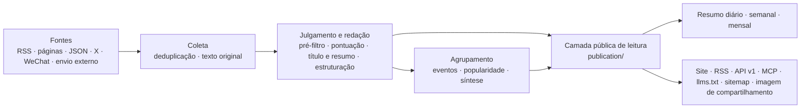

# Arquitetura



## Três processos

| Processo | Local | O que faz |
|---|---|---|
| api | `apps/api/` | Fastify. Interfaces do próprio site (`/api/site/`), API pública (`/api/v1/`), RSS, MCP, interfaces da administração, proxy de imagens, imagens de compartilhamento |
| worker | `apps/worker/` | Fila de tarefas pg-boss e tarefas agendadas: coletar fontes, chamar modelos, agrupar, popularidade, resumos, alertas, limpeza |
| web | `apps/web/` | Páginas com renderização no servidor via React Router. Lê a api só por HTTP e não toca no banco de dados |

Todo o código de negócio está em `packages/backend/`; os tipos e constantes compartilhados entre front-end e back-end ficam em `packages/contracts/`. O nome, os textos, a marca e as páginas deste site ficam em `site/`; as categorias, fontes, prompts e limiares do setor ficam em `industry/`; os recursos que pertencem só a este site ficam em `modules/` (veja “Módulos” abaixo).

## Regras que não mudam

- **Uma única camada pública de leitura**: site, RSS, API, MCP, sitemap e imagens de compartilhamento leem de `packages/backend/src/publication/`. O escopo público, as vagas da seleção (nas saídas para máquinas, cada notícia sai uma só vez) e as condições de evidência factual são definidos apenas em `publication/scope.ts`; novas saídas também respeitam as retratações e as permissões de texto completo em vigor. Relatórios já publicados mantêm a redação da época, mas se uma citação pode ser pública, o nome da fonte e a hora da citação continuam sendo julgados pelos dados atuais; uma retratação também remove o texto de apresentação e a capa que dependem dessa citação.
- **O cache não prolonga a vida de conteúdo antigo**: o conteúdo variável é revalidado ao vencer o `Cache-Control` da resposta; o cache de processo, de disco e HTTP do sitemap compartilham o mesmo prazo final, que não pode ser reiniciado no momento do envio; as respostas HTTP do MCP usam `no-store`. Proxies e CDNs próprios também devem respeitar isso; os requisitos de configuração estão em “Domínio e HTTPS” na [documentação de implantação](deploy.md#domínio-e-https).
- **Páginas não chamam modelos**: ao abrir uma página, o leitor só lê resultados que já estão no banco; modelos só são chamados em tarefas do worker.
- **Requisições pagas têm recibo**: toda requisição paga (modelo, X, WeChat, Jina) registra antes um recibo, e o resultado é guardado antes de ser usado. Se o processo reiniciar ou a tarefa for repetida, o resultado já pago é reaproveitado, sem gastar de novo (`providers/receipts.ts`). Um recibo de resultado incerto é liberado uma vez automaticamente depois de 30 minutos; os artigos parados em estado de falha por causa dele voltam à fila e continuam a extração de texto ou a análise que estava pendente. Se o resultado ficar incerto outra vez, o administrador confere na página “Execução” e libera.
- **Disjuntor de orçamento**: cada serviço pago tem limites por minuto, por hora e por dia; ao passar, ele pausa (na administração, “Configurações → Limites de requisições pagas”).
- **Válvulas de segurança**: `COLLECT_ENABLED`, `MODEL_CALLS_ENABLED`, `FEISHU_CONTENT_PUSH_ENABLED`, `FEISHU_INTERNAL_ENABLED` e `INDEXNOW_SUBMIT_ENABLED` decidem só “se sai ou não”, e não qual lógica é usada; só abrem com `true`, e o que não estiver escrito conta como fechado. O `.env` gerado por `scripts/init-env.ts` liga a coleta e as chamadas a modelos; para mexer só na interface, pode mudar para `false`. Nos testes o envio fica sempre desligado, e coleta e chamadas a modelos só falam com serviços falsos locais.
- **Conteúdo público anônimo**: administradores e visitantes veem o mesmo; favoritos e itens lidos do leitor ficam no navegador. A administração é só para administradores.
- **Conteúdo antigo não inunda a tela**: o material já publicado há mais de 48 horas quando é descoberto, o acervo da primeira importação de uma fonte nova e os envios retroativos são arquivados pela data original, sem entrar em “hoje” e sem notificação; depois da primeira importação, o acervo mais antigo da lista não é mais coletado. O material sem data de publicação confiável não é publicado de imediato; depois que a data é lida, julga-se se é novo ou antigo.
- **Origem rastreável**: toda notícia selecionada tem link para o original; se o texto completo aparece no site é decidido pelo `site_fulltext` da fonte, e por padrão só o resumo é exibido.
- **As regras ficam com o módulo dono**: a administração chama os módulos de conteúdo, eventos, notificações e recuperação, sem reescrever o estado deles; os módulos de negócio não dependem da administração. A edição manual, o resultado público e o registro necessário à recuperação são gravados juntos.
- **Tipos compartilhados nas interfaces entre processos**: as interfaces da administração seguem `packages/contracts/src/admin.ts`, e a carga das tarefas segue o `JobData` de `jobs/queue.ts`; quem envia e quem recebe são verificados juntos. O front-end continua acessando o back-end só por HTTP.

Esses limites entre módulos são verificados por `tests/architecture.test.ts`; ao ajustá-los, atualize juntos a convenção e a verificação. A identidade do site e o modelo de cada etapa são lidos de `site/`, e as categorias e prompts do setor são lidos de `industry/`; o código não fixa valores de um site específico.

## Estrutura de diretórios

| Local | Conteúdo |
|---|---|
| `site/` | O que é próprio deste site: nome e textos, modelo de cada etapa, marca e logo, páginas de termos, os quatro arquivos fixos da raiz do site (`public/`, publicados depois de trocar os marcadores), histórico de atualizações e quais módulos ficam ativos (`site/modules/`) |
| `industry/` | Pacote do setor: categorias e tags, tópicos, fontes de exemplo, prompts, limiares |
| `modules/` | Recursos que pertencem só a este site, uma pasta por recurso (veja “Módulos” abaixo); o framework em si não traz módulos |
| `packages/backend/src/sources/` | Leitores dos seis tipos de fonte e o agendador de coleta (`collect.ts`) |
| `packages/backend/src/content/` | Entrada do material, deduplicação, extração e limpeza do texto |
| `packages/backend/src/editorial/` | Julgamento e redação: `analyze.ts` (fluxo), `prompts.ts` (leitura dos prompts), `models.ts` (qual modelo cada etapa usa) |
| `packages/backend/src/events/` | Agrupamento de eventos, popularidade, síntese do evento |
| `packages/backend/src/publication/` | Camada pública de leitura |
| `packages/backend/src/reports/` | Resumos diário, semanal e mensal |
| `packages/backend/src/providers/` | Chamadas a modelos, vetores, X, WeChat e Jina, recibos e orçamento |
| `packages/backend/src/notify/` | Envio ao Feishu |
| `packages/backend/src/operations/` | Alertas, backup, limpeza, IndexNow |
| `packages/backend/src/admin/` | Interfaces da administração |
| `apps/web/app/routes/` | Um arquivo por página; a tabela de rotas está em `apps/web/app/routes.ts` |
| `database/migrations/` | Migrações do banco, executadas e registradas pela ordem do nome completo do arquivo |
| `scripts/` | Scripts de inicialização, migração, dados iniciais, avaliação e verificação |
| `tests/` | Testes do back-end (o nome do banco precisa terminar em `_test` ou `_ci`, veja abaixo) |

## Módulos

Um recurso que o framework não tem e só o seu site precisa (por exemplo, um ranking ou uma página de monitoramento específicos) vira módulo: uma pasta por recurso, `modules/<nome>/`, que é um pacote npm chamado `@aihot/<nome>` e traz o próprio back-end, interfaces, páginas, estilos, migrações de banco e testes.

| Arquivo | Conteúdo |
|---|---|
| `module.ts` | Os endereços dele: páginas, redirecionamentos, caminhos entregues à api (tipos em `packages/contracts/src/modules.ts`) |
| `server.ts` | Os pontos de encaixe no back-end: interfaces, tarefas agendadas, filas, callbacks de eventos, dados das páginas da administração etc. (`packages/backend/src/modules.ts`, cada ponto indica o arquivo que o lê) |
| `web.tsx` | Os pontos de encaixe no site: páginas, itens de navegação, páginas de tópicos e componentes da administração etc. (`apps/web/app/modules.ts`); o componente que aparece só em uma página fornece uma função de carga, carregada junto com o código dessa página |
| `migrations/` | As tabelas dele, executadas junto com as de `database/migrations/` pela ordem do nome do arquivo |
| `tests/` | Os testes dele, executados junto no `npm test` |
| Outros arquivos | Imagens e outros arquivos estáticos dele também ficam na pasta do módulo: registre a rota no ponto `http` do `server.ts` e entregue com o `sendFile` de `apps/api/src/routes/static.ts` (tipo, ETag, cabeçalhos de cache e 404 ficam por conta dele; o nome do arquivo você mesmo valida), e escreva o endereço em `apiPaths` do `module.ts` |

Depois de pronto, liste-o nas três listas de `site/modules/`: `index.ts` lista os endereços, `server.ts` o back-end, `web.ts` o site (a que ele não usa fica sem ele); e escreva-o também nas `dependencies` do `site/package.json`. Em implantações com Docker, acrescente no `Dockerfile` uma linha `COPY modules/<nome>/package.json modules/<nome>/`, seguindo os outros pacotes. O código do framework não importa nenhum módulo, apenas lê essas três listas, por isso é menos provável haver conflito com os seus recursos ao incorporar atualizações deste repositório. Se os pontos de encaixe não bastarem, acrescente um ponto genérico no framework, em vez de escrever esse recurso dentro dele.

Os módulos oferecem ferramentas MCP por `agent.abilities`. O `scripts/mcp-check.ts` sempre verifica o conjunto completo de ferramentas; o módulo pode fornecer em `mcp.checkArgs` argumentos de verificação que funcionem num banco vazio. Sem isso, só as ferramentas cujo schema de entrada aceita `{}` são realmente chamadas com `{}`; as demais só têm a descoberta verificada, sem adivinhar argumentos. O comportamento de negócio das ferramentas do módulo é verificado pelos testes do próprio módulo.

## Migrações do banco de dados

As migrações já publicadas são histórico de implantação e não podem ser reescritas nem apagadas; correções vão em arquivos novos. As migrações do motor e as dos módulos seguem a mesma convenção: executadas pela ordem do nome completo do arquivo, com o nome completo registrado para saber se já rodaram; arquivos com o mesmo número mas nomes diferentes são executados separadamente, e o mesmo nome completo não pode existir em dois diretórios. A partir de `0055`, cada arquivo contém uma única instrução que pode rodar online; o PR recusa migrações novas fora da convenção e não permite burlar a verificação com números menores. Isso evita que uma instrução que trava a tabela fique, na mesma transação, esperando outras tabelas ou varrendo muitos dados.

Para colunas novas, prefira colunas que aceitam nulo ou com valor padrão constante; ao acrescentar CHECK ou chave estrangeira em tabela existente, primeiro com `NOT VALID` e depois validando em outra migração. Índices usam um `CREATE INDEX CONCURRENTLY IF NOT EXISTS` isolado; numa migração publicada não se faz UPDATE ou DELETE em massa, nem se escondem com DO. O preenchimento de dados precisa ser outra operação, em lotes e observável, validada antes em uma cópia do backup.

Quando vários filtros são correlacionados e o plano de consulta subestima muito o número de linhas, é possível criar estatísticas conjuntas MCV para essas colunas e depois, em outra migração, um `ANALYZE` dessas colunas da tabela indicada. Valide primeiro o ganho com a distribuição real; não crie objetos de estatística sem fundamento, nem faça análise do banco inteiro numa migração, nem pule uma tabela bloqueada presumindo que deu certo.

Mudanças destrutivas, como alterar tipo ou remover coluna, exigem um desenho próprio de atualização e reversão, e o efeito sobre os dados existentes deve ser descrito na [documentação de implantação](deploy.md#atualização); a verificação de migração online atual não as libera diretamente. Para uma tabela que o código já não usa, depois de confirmar que os dados dela podem ser apagados, escreva num arquivo de migração separado `DROP TABLE IF EXISTS <tabela>` (sem CASCADE: se ainda houver objetos que dependam dela, a migração falha), também registrando isso na documentação de implantação. Para ampliar as instruções permitidas, primeiro prove que não bloqueiam por muito tempo as requisições em atendimento e complete as verificações correspondentes; não desative a verificação nem altere o registro antigo.

## Saídas públicas

A relação `related` de um evento precisa, ao ser criada, de pelo menos duas reportagens que a sustentem. O histórico das relações é mantido; depois que uma reportagem-ponte for expressamente retratada, perder a qualificação de reportagem factual pública, virar texto de síntese, sair do fato original ou for negada por um julgamento de agrupamento posterior, se a evidência válida ficar abaixo de duas a relação deixa de ser exibida publicamente, e volta a ser exibida quando houver evidência suficiente. Uma reportagem que simplesmente saiu da janela de recuperação, ou uma revisão comum que mantém o vínculo, não faz a relação expirar. Relações já existentes sem um julgamento de ponte que possa ser conferido não são consideradas retratadas só por falta de registro; se o próprio evento não pode ser lido publicamente, ele continua sem ser recomendado. A semântica de `storyline` não muda com esta regra, e todas as saídas públicas compartilham a mesma regra de leitura.

| Endereço | Conteúdo |
|---|---|
| `/` `/all` `/hot` `/topics` `/daily` `/weekly` `/monthly` | Seleção, todas as atualizações, eventos em alta, tópicos, resumos diário, semanal e mensal |
| `/feed.xml` `/feed/full.xml` `/feed/all.xml` `/feed/daily.xml` `/feed/weekly.xml` `/feed/monthly.xml` | RSS: seleção, seleção com texto completo, tudo, resumo diário, semanal e mensal; há também `/feed/category/<key>.xml` por categoria e a versão com texto completo `/feed/full/category/<key>.xml` |
| `/api/v1/` | API pública, com documentação em `/openapi-v1.json`; o Markdown para Agentes começa em `/api/v1/agent`; a página explicativa é `/agent` |
| `/api/mcp` | Serviço MCP: uma ferramenta para cada um destes: últimas, busca, destaques, eventos, resumo diário, semanal e mensal; o prefixo do nome da ferramenta é o `mcpPrefix` de `site/site.ts` |
| `/llms.txt` `/sitemap.xml` `/robots.txt` | Explicações para modelos de linguagem e mecanismos de busca (arquivos da raiz como `robots.txt` ficam em `site/public/`) |
| `/admin` | Administração |

## Testes

```bash
npm run typecheck
DATABASE_URL=postgres://127.0.0.1:5432/destaques_test npm test
npm run build -w @aihot/web && npm run test:web
```

O nome do banco em `DATABASE_URL` precisa terminar em `_test` ou `_ci`; se não existir, é criado e migrado automaticamente. Cada arquivo de teste roda em paralelo em uma cópia dele, por isso a conta do banco precisa de permissão para criar bancos (`CREATEDB`). Os testes não acessam nenhum serviço externo: modelos e interfaces pagas são respondidos por serviços falsos locais.
